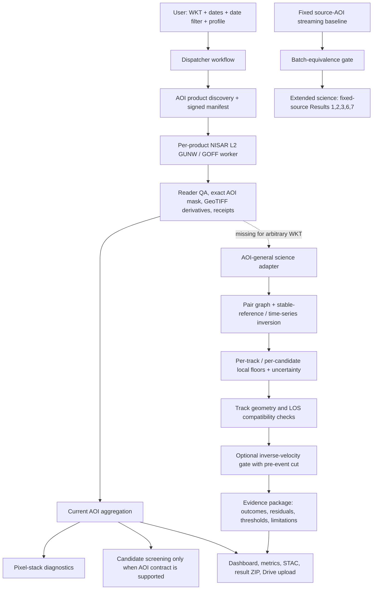

# SARGuardian Science Engine — Architecture Blueprint

## Goal

For a user-defined EPSG:4326 WKT polygon and date window, produce a reproducible, scientifically auditable chain from NISAR L2 products to measured displacement evidence. The map/dashboard is a presentation layer over these records; it must not invent missing measurements or turn structural success into a hazard alert.

## Current and target flow

The dashed connection from per-product outputs to the general science adapter is the principal implementation gap. The fixed-source route is a separate branch of the architecture, not a substitute for that adapter.

## Layer contracts

### 1. Request and discovery contract

- Validate WKT as one supported polygon ring; record coordinate convention and the exact normalized polygon hash.
- Preserve inclusive date semantics and the selected filter mode; record which product acquisition date(s) each rule tests.
- Emit a manifest with product ID, GUNW/GOFF family, reference/secondary dates, track/orbit/path, processing maturity, source URL/identifier, and exact science/backend pins.
- Treat `validation-pilot` and `full-aoi-baseline` as different run intents. Never silently expand a pilot or silently claim it is a full baseline.

### 2. Per-product measurement contract

- Keep GUNW phase-derived LOS and GOFF offset-tracking measurements as distinct data families with explicit units and measurement semantics.
- Keep ascending and descending tracks separate at the pair-network inversion stage. Never connect pairs across incompatible track/path/processing families.
- Preserve acquisition-pair metadata, source granule identity, CRS, transform, pixel spacing, product maturity, masks, and a digest of each derived output.
- Record source valid pixels, AOI-intersection pixels, coherence/quality-mask counts where applicable, and why a product was excluded. Zero-data is not success.

### 3. Pair-network/time-series contract

- Build the graph from actual reference/secondary epochs; ensure all nodes in a reported component are connected and explicitly describe the reference epoch.
- Use the same grid and mask across a comparable stack, or explicitly reproject with a recorded method and registration check; do not silently align by array index.
- Reference each compatible stack to an explicit stable-area strategy with source-AOI and target/candidate exclusions recorded. If stable support is too small or inconsistent, return `INSUFFICIENT_DATA`.
- Report per-track output, observations/pairs used, rejected pairs, residual RMS, uncertainty, degrees of freedom, network connectivity, and support counts. Never bridge disconnected temporal components or label a pairwise median as cumulative displacement.

### 4. Local floor and target evidence contract

- Compute candidate/local floors from the exact submitted candidate set and AOI, with the target centre, window/radius, mask, quality threshold, number of finite pixels, estimator and uncertainty recorded.
- Distinguish a missing/unsupported target from a measured quiet target. Keep GOFF units/semantics separate from GUNW LOS millimetres.
- Do not use fixed `scar_candidates_source.csv`, fixed coordinates, or the source polygon for an arbitrary AOI unless that is explicitly the requested study and provenance confirms it.

### 5. Geometry and inverse-velocity contract

- Record each track's look/incidence/heading and the terrain/DEM source used for geometry analysis. Coverage or a sensitivity score is not itself measured motion.
- Only combine geometries with a documented projection model, sufficient compatible observations, and propagated uncertainty. Do not combine raw ascending/descending phase.
- Inverse-velocity requires a vetted displacement series, a compatible floor/noise table for the same target and geometry, adequate temporal support, and an explicit event/cutoff date. Event/post-event observations cannot leak into a claimed precursor forecast.
- A no-alarm, invalid fit, insufficient support, or skipped unsupported stage is a valid result and must remain visible.

### 6. Bound/report contract

- Replace fixed output-path assumptions with explicit input/output paths and an AOI/target record; preserve the source-study bound as a separate reproduced reference result.
- A dynamic AOI report must not inherit source-AOI headline numbers unless it states that they are contextual reference values rather than measurements at the submitted AOI.
- Each result needs machine-readable status, source inputs/hashes, source-code pin, exact command/parameters, output hashes, uncertainty, exclusions and caveats.

### 7. Presentation and retention contract

- The viewer consumes only the verified result package. It may show rasters, support counts, per-pair observations, valid time-series points, thresholds and status/provenance.
- Timeline playback changes which observed product/epoch is shown; it must not interpolate motion or forecast a future map.
- Keep display-build status separate from science-stage status. Preserve the existing private Drive upload, output receipts, and raw-data retention boundaries.

## Implementation sequence

1. **Routing guard (this PR):** route the manual WKT dispatcher to the merged `main` workflow and test that contract.
2. **Contract inventory:** define schema for pair records, per-product rasters, candidate points, local floors, per-track series and stage statuses.
3. **AOI adapter:** pass the exact WKT/CRS and the manifest-derived targets into adapters rather than importing named source polygons or fixed CSV paths.
4. **Time-series implementation:** add a tested network inversion path for the dynamic exported measurements; compare against the established `src/timeseries.py` semantics, or call the unmodified script only after its AOI/grid/data contract is shown to support arbitrary WKT. Do not maintain two subtly different algorithms without parity tests.
5. **Local floors and target list:** generalize inputs/geometry contract, preserving the fixed-source research result.
6. **Geometry assessment:** explicit track/target coordinate inputs, DEM provenance and coverage outputs.
7. **Inverse-velocity/bounds:** consume only fresh, compatible time-series/floors; make event/cutoff and output paths inputs; refuse stale/fixed-source files.
8. **Synthetic + regression validation:** known-motion, no-motion, disconnected network, masked/low-support target, track mismatch, CRS mismatch, stale-output refusal, event leakage and zero-valid-pixel cases.
9. **Pilot release gate:** run a small explicitly selected AOI after the code changes are reviewed; inspect every stage and bundle hash. Run a full AOI processing only after pilot gates pass.

## Release criteria

The new-place pipeline is not complete until (a) its entry point resolves to the intended workflow, (b) each stage has a test proving it received the requested AOI, (c) the manifest and science report link the same pair IDs and pins, (d) the result bundle contains the scientific outputs and per-stage provenance, and (e) the dashboard exposes limitations instead of implying a validated hazard. A green GitHub Actions conclusion alone is insufficient.
