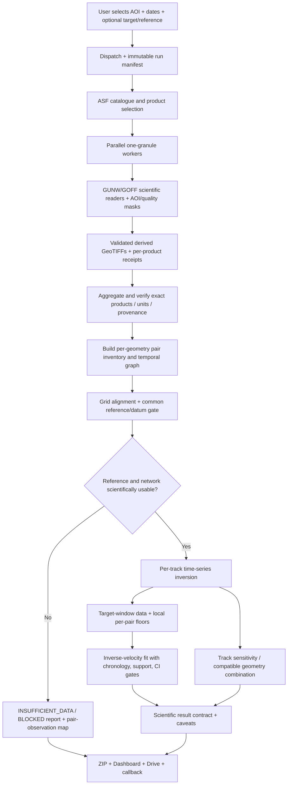

# Architecture: Dynamic-AOI Scientific E2E

## Objective

For a selected AOI/date window, turn validated per-product NISAR outputs into a defensible progression:

**catalogue + AOI/date manifest → per-product readers → retained georeferenced measurements → common spatial reference + pair network → per-geometry LOS time series → local detectability → guarded inverse-velocity analysis → geometry interpretation → result bundle + interactive dashboard.**

Each arrow is a tested contract. A stage may return a scientifically meaningful blocked/insufficient state; no later stage may fabricate values to hide it.

## System boundaries

- **Acquisition/retention boundary:** the existing one-product workers remain responsible for authenticated download, identity/maturity checks, exact AOI preflight, official pinned reader execution, derived-output validation, durable Drive retention and cleanup receipts. The new analysis stage must reuse these derived outputs; it must not redownload HDF5.
- **Science boundary:** execute the pinned science implementation, record all command arguments/results, enforce units, reference, geometry, sample-support and uncertainty checks.
- **Presentation boundary:** read the result contract and display real measurements; do not infer scientific meaning from an arbitrary product median or raster color stretch.
- **Warning boundary:** a candidate trend is a research signal, not an operational alert. No alert becomes authoritative until the complete method is tested on historical held-out events and non-events with calibrated false-alarm/missed-event metrics.

## Target architecture

The diagram's “optional target/reference” inputs are an intended contract addition. Until they are wired into the live form and dispatcher, absent target/reference values must be recorded explicitly and must not be guessed silently.

## Processing contracts by stage

### Stage 0 — Version and request identity

Capture:
- `run_id`, `workflow_ref`, workflow SHA, manifest SHA and immutable orchestration SHA.
- Science engine SHA and per-file/script hashes for every analysis script.
- AOI canonical WKT + SHA-256, EPSG:4326, start/end dates, date-filter mode and catalogue query details.
- Per-product source granule, family, processing type/CRID/maturity, pair endpoints, track/path and direction.
- Optional target point (lat/lon) and stable-reference polygon/method, or an explicit `NOT_PROVIDED`.

Hard fail on mismatched pins or product identities. The dispatcher, reusable workflow and worker orchestration revision must be aligned. Do not pin the dashboard builder to one revision while the data manifest and workers come from another unless a documented compatibility contract and integration test prove it safe.

### Stage 1 — Product science/quality extraction

Continue using the existing pinned `gunw_reader.py` and `goff_reader.py` from `10639a916c9829850775410b3ed7de62e527770d`.

For each raster, read its metadata, not guessed conventions:
- CRS, transform, shape, pixel size, band descriptions/units, NoData, AOI mask evidence, valid-pixel count and source export identity.
- For GUNW, keep LOS displacement and coherence/unwrapping quality gates separate.
- For GOFF, identify the exact layer and range/azimuth-offset units. The layer2 choice is a contract, not a synonym for GUNW.
- A structural PASS with zero valid target pixels means the target measurement is unavailable; it does not imply “zero movement”.

### Stage 2 — Spatial grid and reference gate

A temporal inversion needs the same type of pairwise displacement between observations. Per-product private references cannot be presumed interchangeable.

1. Group products by family and physical acquisition geometry before inversion. Keep ascending and descending separate.
2. Validate that raster footprints overlap the exact AOI and the target. Reproject/regrid using an explicit target projected CRS/grid, preserving NoData and AOI masks. Do not assign a different CRS tag without resampling.
3. Build the common finite-pixel mask for each connected track/family stack.
4. Prefer a user-confirmed reference polygon outside the moving target. Record its WKT/hash and the pixels actually used. The reference must be checked against AOI/event/runout exclusion rules.
5. If no reference polygon is supplied, a common-pixel reference away from the target may be explored only as a clearly labelled **provisional relative datum** after the sample and stability diagnostics pass. Never describe that as geodetically stable ground.
6. The current `common_ref.py` implementation assumes all arrays already share a lattice and requires at least 200 common pixels. A small or incoherent AOI may not support this; return `NO_COMMON_REFERENCE` instead of subtracting a guessed zero.

Record the selected reference, buffer radius, number/fraction of eligible common pixels, mask hashes, grid CRS/transform, rejected pair list, and the exact failure reason.

### Stage 3 — Temporal network + time series

Use the official pinned `timeseries.py` inversion primitives through an adapter for retained exports. Do not call its raw-directory mode on a directory containing only GeoTIFFs.

For each (family, mission/track, direction, path, layer) group:
- Create pair records from exact granule metadata and actual acquisition timestamps.
- Attach measurements only after the reference gate passes.
- Build the graph of acquisitions (vertices) and interferograms (edges); detect connected components. Invert each component separately.
- Require enough independent edges for redundancy and publish the degrees of freedom/residual RMS; if error bars are undefined, display them as unavailable.
- Keep the line-of-sight (LOS) series as the primary reported result. If the graph is disconnected, do not bridge it. Different component zeros are independent.
- Produce `time_series_gunw.csv/json/png` and `time_series_goff.csv/json/png`, plus per-group diagnostics. The formats must expose dates, component IDs, units, positive sign, datum description, uncertainty, pixel support and the product IDs involved.

A useful output is allowed to be “no defensible time series”. An empty or disconnected network is never converted into a smooth line by interpolation.

### Stage 4 — Local detectability

Run `local_floor.py` only after a target coordinate is inside the exact polygon and the right raster band/units have been verified.

Compute one floor per pair/layer at the target window, with:
- local valid pixels, requested/effective window size, coherence/correlation mask, pair span and layer;
- robust floor estimate and bootstrap confidence interval;
- AOI/block-median floor when enough blocks support it;
- status such as `MEASURED`, `INSUFFICIENT_LOCAL_PIXELS`, `OUTSIDE_AOI`, `NO_DATA_AT_TARGET`, or `UNSUPPORTED_BAND_UNITS`.

Never treat a fixed scalar floor measured at a different target/track as an exact substitute when per-pair floors are available. Missing/non-finite floors must disable the forecast gate, not make it easier to fire.

### Stage 5 — Inverse-velocity gate

Run `inverse_velocity.py` only on an observed cumulative displacement series whose reference and datum passed Stage 2; do not use the dashboard's list of pairwise medians as its input.

- Join each velocity interval to the correct measurement floor for its pair/geometry/layer.
- Enforce data cutoff: no acquisition interval ending on or after a claimed historical forecast cutoff can enter the fit.
- Enforce the source script's minimum number of consecutive above-floor velocity intervals, accelerating-trend sign, R² gate and forecast horizon.
- Retain fit points, residuals, R², confidence interval boundedness, last eligible observation, any excluded samples and reason for a negative result.
- Return `NOT_EVALUATED`, `INSUFFICIENT_DATA`, `NO_QUALIFYING_ACCELERATION`, `CANDIDATE_FOR_REVIEW`, or `MODEL_UNRESOLVED`. Never display a point-estimated failure date as certain, especially when the 95% interval is unbounded.
- A “candidate” is not an external warning without an independently calibrated decision policy.

### Stage 6 — Geometry and motion components

Use `geometry_merge.py` only after each track's series is independently inverted on compatible references.

- Prefer per-product look vectors/incidence metadata from the actual GUNW when available; otherwise record the nominal geometry assumptions and their limits.
- Use a validated DEM slope/aspect, test sensitivity to the terrain stencil, and reject low-sensitivity/ill-conditioned projections.
- The current script contains a finite table of NISAR/Sentinel-1 tracks and named-AOI map choices. General-AOI support requires metadata-driven `Track` construction; do not invent a track by nearest-name matching alone.
- The merge must carry covariance/uncertainty and stable-reference compatibility. The dashboard must continue displaying the original LOS results alongside any derived downslope/E/U values.
- Do not report 3-D displacement from a single look direction. Even ASC/DESC decomposition needs adequate independent geometry and error conditioning.

### Stage 7 — Scenario-specific bound, not general processing

Do not call current `bound.py` in every AOI run. It is keyed to the 26-Aug-2026 source event, selected dates/tracks, a published precursor assumption, candidate-screening outputs and a source-AOI polygon.

Refactor it later into:
- a scenario configuration (event date, candidate region, independently sourced benchmark, track/pair policy, units and citations);
- a pure calculation layer;
- an evidence report recording the assumption/source and every candidate/track included or excluded.

For a different site without a known event/ground truth, return `NOT_APPLICABLE_NO_SCENARIO`, not an empty or misleading bound.

### Stage 8 — Result contract, ZIP, API and dashboard

The new stage writes under `science-analysis/` before the final archive is assembled. Suggested files:
- `analysis-manifest.json` (all hashes, settings, units and versions)
- `analysis-report.json` (per-stage status/errors/warnings)
- `pair-inventory.csv`
- `time_series_gunw.csv`, `time_series_goff.csv`
- `local-detection-floors.csv`
- `inverse-velocity-results.json`
- `geometry-results.csv/json`
- charts and optional aligned/diagnostic rasters
- `README_SCIENCE_RESULTS.md` (short interpretation guide and non-claims)

Dashboard schema additions should display:
1. verified raster layers + pair timeline;
2. per-geometry cumulative LOS series with error/support and disconnected components separated;
3. per-pair support/floor plot;
4. guarded inverse-velocity fit/uncertainty only when fit eligibility passes;
5. track sensitivity and derived motion with assumptions;
6. the reason a stage is blocked/not evaluated.

Keep `web_dashboard.status` separate from `scientific_analysis.status`, and both separate from acquisition/processing `status`. A display-only failure must not erase scientific outputs; a scientific-analysis failure must not make a successful product reader look like no products were processed. Existing Drive upload, checksum receipts, callback authentication and result download must remain.

## Status state machine

| Status | Meaning |
|---|---|
| `PASS` | Required computation ran and all declared contract checks passed; says nothing by itself about external truth |
| `PARTIAL` | Some valid products/stages exist, with explicit failed/blocked stages |
| `INSUFFICIENT_DATA` | The observation/reference/support/network requirements do not allow a defensible estimate |
| `BLOCKED_CONFIGURATION` | Required target/reference/band/geometry settings are absent or contradictory |
| `NOT_APPLICABLE` | Scenario-specific analysis (such as current `bound.py`) does not apply to this AOI |
| `FAIL` | Invalid input, corrupt/mismatched source, code failure, or violated invariant |

## Implementation order

1. Pin/reference audit and regression fixtures.
2. Context, architecture, checklist and output schema.
3. Safe export inventory/reprojection/reference preflight with statuses.
4. Generic time-series adapter + synthetic numerical tests.
5. Target floors + pair-specific joins.
6. Inverse-velocity integration + no-future-data tests.
7. Geometry-metadata audit and conditional combination.
8. Scenario-bound refactor; keep default AOI run `NOT_APPLICABLE`.
9. Workflow/dispatcher and dashboard/API integration.
10. Authorized custom-AOI acceptance run, then event-holdout scientific validation.

No raw NISAR replay should be started for coding tests. Use synthetic raster fixtures and existing derived-output artifacts until the implementation passes its tests; the real data run needs the user's explicit dispatch.
